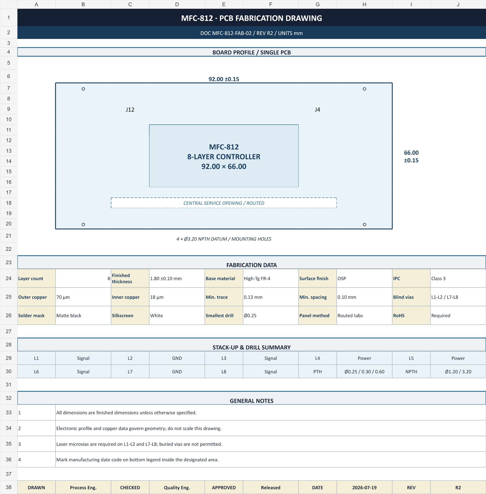

# MFC-812 R2 复杂样例验收说明

> 本文件只供验收使用，不登记为项目资料，也不发送给模型。机器可读预期以 `expected_results.json` 为准。

## 1. 制造图要求

验收对象：`../materials/MFC_812_R2_FAB.png`。

- 图像尺寸为 2352 × 2386 px；放大后尺寸、孔径、公差和表格文字仍应清晰。
- 制造图必须是独立来源，不能由 XLSX 直接截图生成，也不能复述 XLSX 的排版。
- 顶部必须显示板号 MFC-812、文档号、REV R2 和单位 mm。
- 板框区必须可辨识 92.00 × 66.00 mm 外形、4 个 Ø3.20 NPTH 安装孔、中央 routed opening 和主要定位标记。
- `FABRICATION DATA` 必须完整显示层数、成品板厚、铜厚、最小线宽/线距、表面处理、IPC 等级、盲孔、阻焊、字符、最小钻径和拼板方式。
- `STACK-UP & DRILL SUMMARY`、`GENERAL NOTES` 和底部签核/版本栏不得裁切。
- 不允许出现“验收结论、预期冲突、预期违规、测试样例”等提示；图中只能陈述该来源自己的工程事实。

## 2. 工作簿要求

验收对象：`../materials/MFC_812_R2_SPEC.xlsx`。

| Sheet | 内容要求 | 计算/视觉要求 |
|---|---|---|
| `制造规格` | 基本结构、线路、孔、表面处理、阻焊字符、等级、拼板与工程备注 | 数值保持数值类型；分区清楚；无裁切 |
| `叠层` | 8 层铜厚、介质厚度、材料和功能 | 铜厚合计 0.178 mm、介质合计 1.422 mm、名义厚度 1.600 mm 均由公式计算 |
| `钻孔与拼板` | 3 × 2 拼板、板间距、工艺边和孔表 | 拼板数量公式结果为 6；孔类型、孔径和数量可读 |

全工作簿公式错误数必须为 0；每个 sheet 都要单独渲染检查标题、边框、列宽、换行和备注区。

## 3. 多来源关系与规则预期

| 字段 | XLSX | 制造图 | Gerber | 应保留的关系 | 现有规则库预期 |
|---|---|---|---|---|---|
| `layer_count` | 8 | 8 | 8 | 一致 | 无直接规则 |
| `board_size_mm` | 92 × 66 | 92 × 66 | 92 × 66 | 一致 | 无直接规则 |
| `board_thickness_mm` | 1.60 mm | 1.80 ±0.10 mm | — | 冲突，两个候选均保留来源 | `finished_thickness_max_170` → `insufficient_information` |
| `min_trace_width_mm` | 0.13 mm | 0.13 mm | 0.13 mm | 一致 | 无直接规则 |
| `min_trace_spacing_mm` | 0.15 mm | 0.10 mm | 独立测量候选 | 冲突，禁止静默覆盖 | `trace_spacing_min_0125` → `insufficient_information` |
| `outer_copper_thickness_um` | 35 μm | 70 μm | — | 冲突，禁止静默覆盖 | 当前规则库不消费 |
| `surface_finish` | ENIG | OSP | — | 冲突，禁止静默覆盖 | `surface_finish_enig` → `insufficient_information` |
| `blind_vias` | 有，L1-L2/L7-L8 | 有，L1-L2/L7-L8 | 辅助几何 | 一致 | `blind_vias_not_allowed` → `violation` |
| `ipc_class` | Class 3 | Class 3 | — | 一致 | `ipc_class_3_required` → `no_violation` |

规则判断的前提是整合字段状态正确：发生资料冲突时必须保留来源地址、Evidence 和候选值，不得先挑选一个值再执行规则。

## 4. Gerber 与层定义要求

- 一个逻辑 Gerber job，8 个铜层、17 个待定义层、77,024 个解析对象。
- 17 张 SVG preview 使用同一个 `viewBox=-0.05 -0.05 92.1 66.1`。
- `layer_definition_profile.json` 必须按 `file_path` 唯一匹配全部层，导入后只保存未确认草稿，不自动 Confirm。
- 确定性预检只覆盖资料登记、Gerber preparation、preview 和草稿保存；完整多来源整合与五条规则的实际结果必须另行通过正式产品链验收。